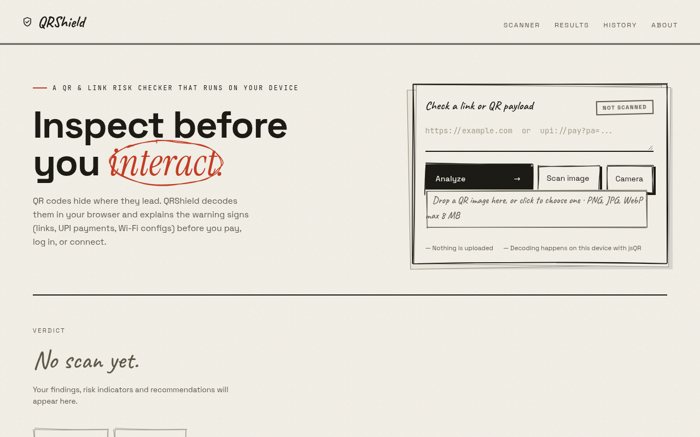
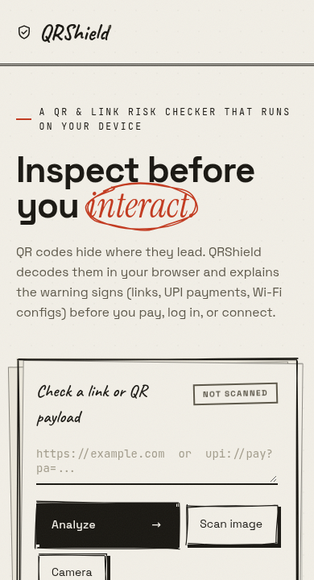

# QRShield — QR Code Security Analyzer

A cybersecurity internship project. Scan a QR code with your camera or an image, paste a link, and review transparent, rule-based security indicators. Optionally checks links against Google's Web Risk threat list through a small server-side endpoint. It also parses India-focused UPI payment QR fields and exports text or PDF security reports.

## Features

- Live camera QR decoding and image upload using `jsQR` (decoded on your device)
- URL analysis: HTTPS, embedded credentials, IP-style hosts (decimal/hex/octal/IPv6), punycode, lookalike and brand-impersonation domains, shorteners, encoded and double-encoded paths, urgency wording
- Optional live phishing check via Google Web Risk (server-side API key; honest "Not checked" when unavailable)
- UPI QR inspection: payee VPA, displayed recipient name, amount, currency, payment note
- Wi-Fi and contact card recognition
- Explainable, cautious verdicts: no result is ever called "safe"
- Local `.txt` and PDF report export (PDF generated on-device with jsPDF)
- Optional scan history, private and local-only (browser localStorage), pausable and clearable
- Responsive dark UI, no login, no database, no tracking

## Run locally

Requires Node.js 20.19+ (or a compatible recent version).

```bash
npm install
npm run dev
```

Open the localhost URL printed by Vite. For camera access on phones, serve over HTTPS and allow permission.

```bash
npm test          # 46 unit tests
npm run build     # production build to dist/
npm run preview   # serve the production build locally
```

## Live threat-intelligence setup (optional)

The app works fully offline with local heuristics. For live checks it calls `GET /api/check-url?uri=<url>`, implemented as a serverless function in `api/check-url.js` (Vercel Node runtime). The function holds the API key; the browser never sees it.

1. Create a Google Cloud project and enable the **Web Risk API**.
2. Create an API key and restrict it to the Web Risk API.
3. Set it as an environment variable on the host: `WEBRISK_API_KEY=...` (never commit it; `.env` files are git-ignored).
4. Deploy. Only `http(s)` URLs are sent for checking, and the UI tells the user this. UPI, Wi-Fi and text payloads never leave the device.

Web Risk's Lookup API (`uris:search`) is free for up to 100,000 calls/month per account ([pricing](https://cloud.google.com/web-risk/pricing)); usage beyond that is billed by Google, so keep the key restricted and monitor quota. The older Safe Browsing API v4 is deprecated; Web Risk is its currently supported replacement. When the key is missing, quota is exhausted or the API fails, QRShield shows **"Not checked"**, never a safety verdict.

## What the code does

- `src/analyzer.mjs` — all deterministic URL and UPI rules and the scoring model
- `src/threatintel.mjs` — client for the optional live check (timeout + failure → "Not checked")
- `src/history.mjs` — local-only scan history (max 50 entries, truncated payloads)
- `src/report.mjs` — shared report model, `.txt` and PDF builders
- `src/main.js` — scanner, UI wiring, exports
- `api/check-url.js` — serverless Web Risk endpoint
- `tests/` — 46 unit tests (rules, history, reports, threat-intel client)

## Security notes

- All user content is rendered through an HTML escaper; no raw injection into the DOM
- Content-Security-Policy meta tag (also configure `frame-ancestors` as a server header on the host)
- No QR destination is ever visited automatically; nothing executes a QR payload
- Payload size capped (12,000 chars); image uploads capped at 8 MB
- `npm audit`: 0 known vulnerabilities at submission time

## Security limitations

This is an educational prototype, **not a commercial threat detection product**. Heuristic scores are illustrative, not calibrated probabilities. It cannot verify a UPI recipient's identity or guarantee a URL is safe, and a "not on the list" live result is not proof of safety either. Verify payments and links independently in a trusted app.

## License and attribution

- [jsQR](https://github.com/cozmo/jsQR) — Apache-2.0 — QR decoding
- [jsPDF](https://github.com/parallax/jsPDF) — MIT — local PDF generation
- [Vite](https://github.com/vitejs/vite) — MIT — build tooling
- [Rough.js](https://github.com/rough-stuff/rough) — MIT — hand-sketched frames and pen marks in the interface
- [Caveat](https://fonts.google.com/specimen/Caveat) — SIL Open Font License — handwriting typeface used for interface labels

These are separately licensed open-source dependencies, not original work of this project. Everything else in this repository is original project code; see CONTRIBUTIONS.md.

### UI design credits

The v3/v4 interface is original code (vanilla CSS/JS, no copied components), with its visual language and interaction ideas informed by:

- **Google Stitch** (stitch.google.com) — initial "Cyber Sentinel" layout concept (sidebar console, telemetry bar, palette). Layout re-implemented by hand; no generated code shipped. Stitch's placeholder statistics were not carried over.
- **microkit** ([github.com/henriquegpb/microkit](https://github.com/henriquegpb/microkit), MIT) — microinteraction ideas: press states, staggered row entrances.
- **Magic UI** ([github.com/magicuidesign/magicui](https://github.com/magicuidesign/magicui), MIT) — shimmer/sheen button idea.
- **React Bits** ([github.com/DavidHDev/react-bits](https://github.com/DavidHDev/react-bits), MIT + Commons Clause) — decrypted-text and spotlight-card ideas. Note: the Commons Clause forbids selling substantially derived software; this project is a non-commercial educational prototype. Re-implemented in vanilla JS from the published concept; no React code copied.

## Screenshots

Real captures of the live app (https://qrshield-lac.vercel.app):



